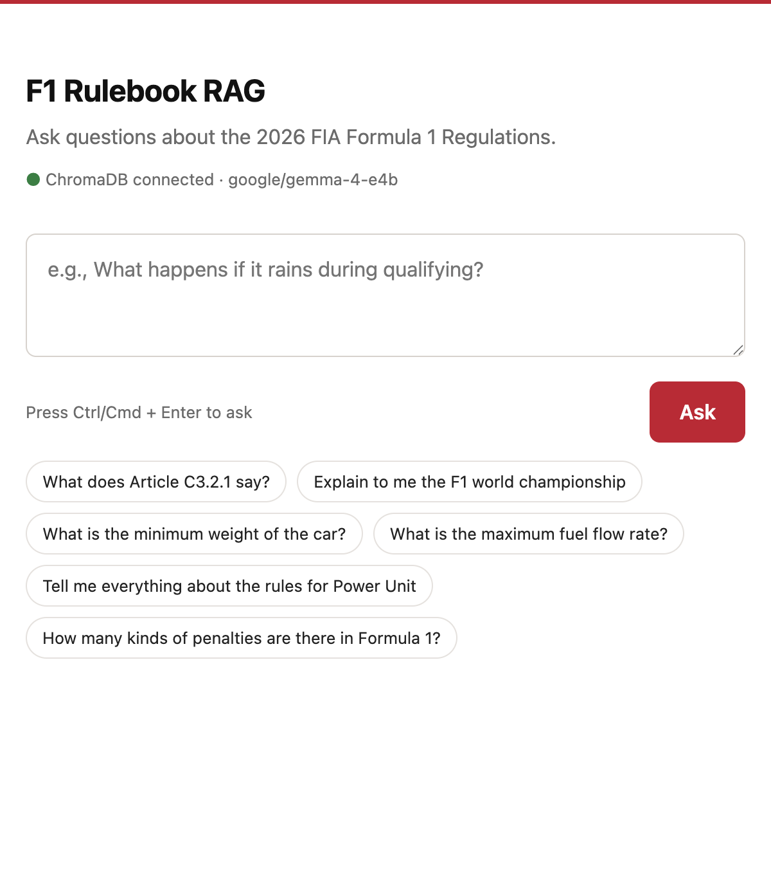
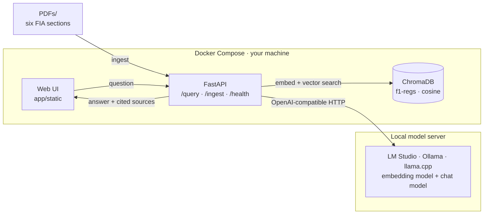
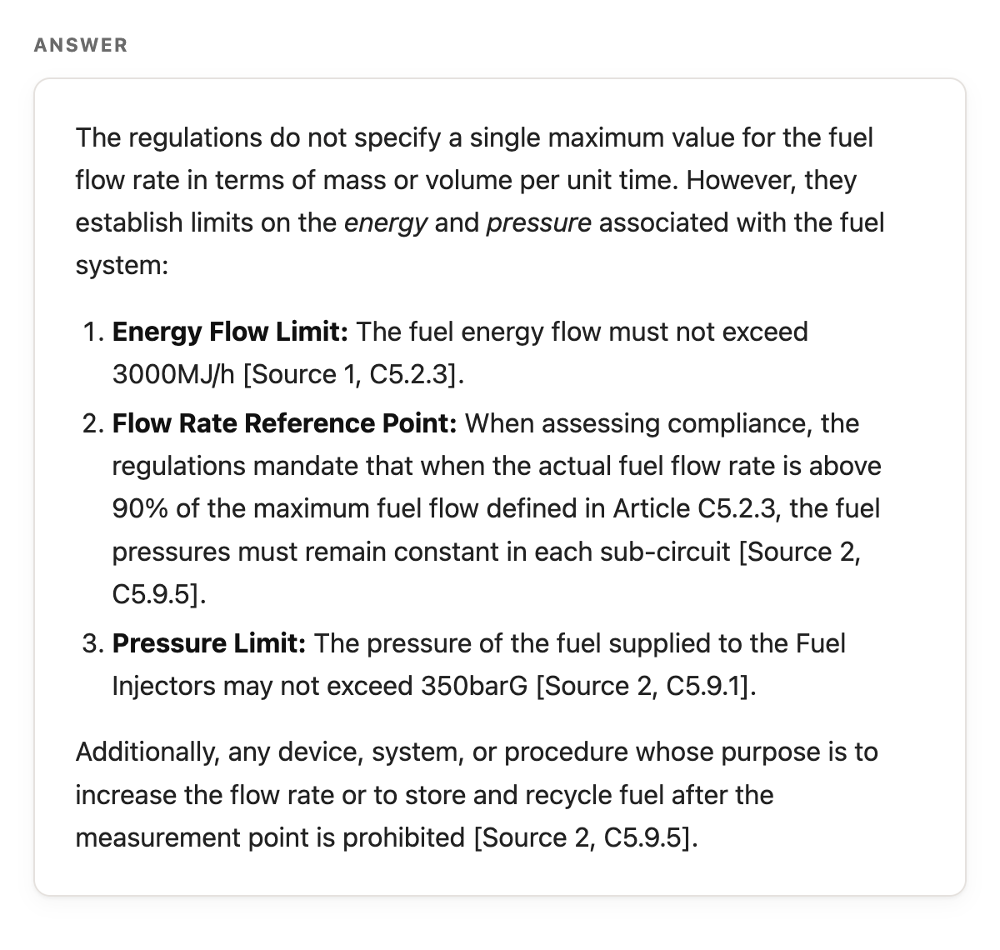
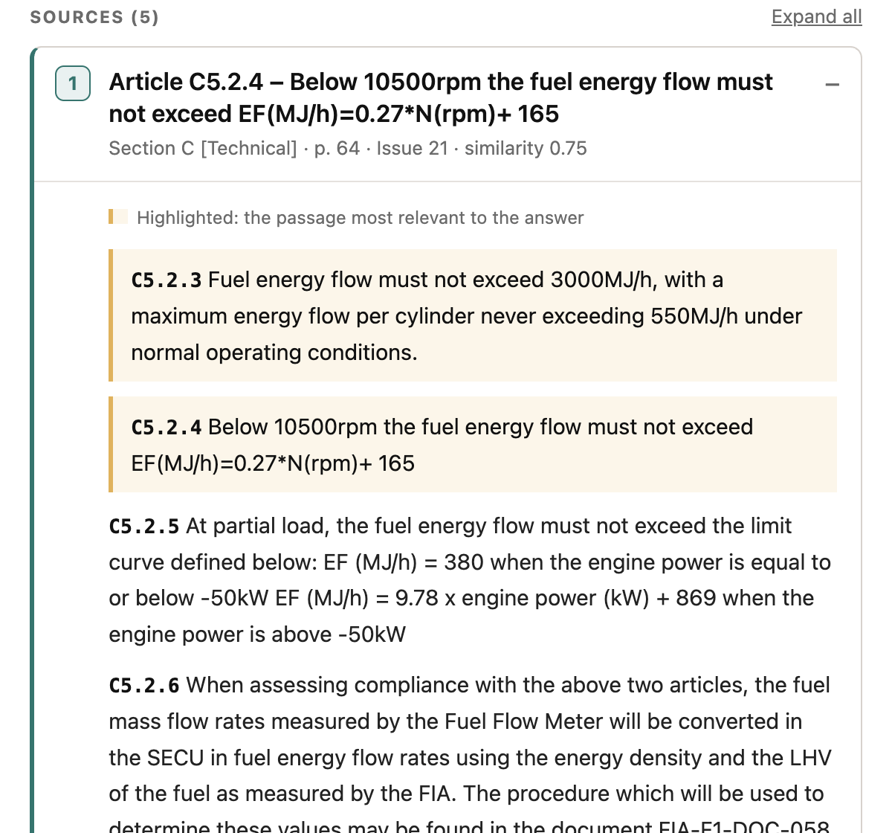

<div align="center">

# 🏎️ F1 Rulebook RAG

**Ask the 2026 F1 rulebook. Fully local, fully cited.**

[](https://www.python.org/)
[](https://fastapi.tiangolo.com/)
[](https://www.trychroma.com/)
[](https://docs.docker.com/compose/)
[](docs/adr/0001-local-only-inference.md)
[](docs/EVALUATION.md)
[](LICENSE)

[Quick start](#-quick-start) · [How it works](#-how-it-works) · [API](#-api) · [Evaluation](#-evaluation) · [Docs](#-documentation)



</div>

A retrieval-augmented generation system over the six **2026 FIA Formula 1 Regulations** PDFs. It finds the clauses that actually bear on a question, answers in plain English, and shows the exact passage it relied on — page, issue and all.

Everything runs on your machine. Embeddings and answers come from an OpenAI-compatible server (LM Studio by default).

## ✨ Highlights

- **Fully local inference.** Local embeddings + local chat model, vendored UI assets, Chroma telemetry disabled.
- **Measured with RAGAS.** Answers are scored for faithfulness (0.88), context recall (0.91) and answer correctness (0.78).
- **Clause-aware, not chunk-blind.** Ingestion splits the rulebook by article and clause (`C5.2.4`), merges parts back before display, and never cites half a clause.
- **Answers are grounded.** The model is asked to cite each claim as `[1]`, `[2]`… and the paragraph it relied on is highlighted in the source card.
- **Direct lookup.** Ask about `C3.5.2` or `Article C5` and those clauses are fetched even if similarity ranking would have missed them.

Two containers (API + ChromaDB), one REST API, one small web UI, and OpenAPI docs at `/docs`.

## 📈 Results

Measured on the committed baseline (30 verified questions; `google/gemma-4-e4b` generator, `qwen/qwen3.5-9b` judge):

| Metric             | Mean  |
| ------------------ | ----- |
| Faithfulness       | 0.882 |
| Context recall     | 0.906 |
| Context precision  | 0.867 |
| Answer correctness | 0.775 |
| Clause recall      | 0.819 |

Full breakdown, caveats, and known limitations: [`docs/EVALUATION.md`](docs/EVALUATION.md).

## 🏗 How it works



**Ingestion:** PDF → pymupdf → clause-aware chunks → embeddings → ChromaDB.

**Query:** question → direct clause lookup (if it names one) + vector search → grouped, expanded clauses → threshold filter → prompt with excerpts → answer with `[n]` citations → source cards with highlighted paragraphs.

The retrieval pipeline, in order:

1. **Direct lookup** — clause/article codes in the question fetch those clauses (`match: "article_number"`, similarity `1.0`), capped at 2 sources.
2. **Semantic search** — embed the question and pull `top_k × 3` candidate chunks.
3. **TOC filter** — table-of-contents chunks are dropped before ranking.
4. **Grouping** — chunks collapse into one source per clause, keyed by document + article + page.
5. **Expansion** — the clause is reassembled from its parts (capped at 3,500 chars; long clauses are marked `truncated`).
6. **Threshold filter** — sources below `similarity_threshold` are dropped and refs are renumbered with no gaps.

See [`docs/ARCHITECTURE.md`](docs/ARCHITECTURE.md) for the full diagram and [`docs/adr/0001-local-only-inference.md`](docs/adr/0001-local-only-inference.md) for why this is local-only.

## 🚀 Quick start

### Prerequisites

- Docker + Docker Compose
- [LM Studio](https://lmstudio.ai/) (or any OpenAI-compatible server) on the host

### 1. Load two models

- **Embedding model:** `text-embedding-bge-large-en-v1.5`
- **Chat model:** `google/gemma-4-e4b`
- **Judge model:** `qwen/qwen3.5-9b`

Start the server on port **1234** (Developer tab → Start Server). The names must match `config.yaml`; edit that file if yours differ.

### 2. Start the services

```bash
git clone https://github.com/faizjauzah/f1-rulebook-rag.git
cd f1-rulebook-rag
./run.sh start
```

Wait for `Application startup complete` and a healthy ChromaDB.

### 3. Ingest the PDFs (once, ~5–10 min)

```bash
./run.sh ingest
```

Six PDFs become roughly 3,000 clause chunks. Embeddings are generated **before** the old collection is deleted, so a failed run won't wipe existing data.

### 4. Ask something

Open <http://localhost:8000>, or:

```bash
./run.sh query "What is the maximum fuel flow rate?"
```

No API key step. `.env` can stay empty.

### Helper commands

| Command              | What it does                                      |
| -------------------- | ------------------------------------------------- |
| `./run.sh start`     | Build and start API + ChromaDB (foreground)       |
| `./run.sh stop`      | Stop the containers                               |
| `./run.sh ingest`    | Re-ingest every PDF (recreates the collection)    |
| `./run.sh query "…"` | POST a question and pretty-print the JSON         |
| `./run.sh health`    | Print `/health`                                   |
| `./run.sh eval`      | Run the 30-question eval inside the API container |
| `./run.sh logs`      | Follow API logs                                   |
| `./run.sh clean`     | Remove containers and `data/`                     |

## 💡 Usage



Type a question, press <kbd>Ctrl</kbd>/<kbd>Cmd</kbd> + <kbd>Enter</kbd>, and read the answer. Citation links jump to the source cards; the paragraph(s) the answer relies on are highlighted.

Example questions:

- "What is the maximum fuel flow rate?"
- "What is the minimum weight of the car?"
- "How are cost cap penalties determined?"
- "What happens if it rains during qualifying?"

### Answers you can check

The answer card cites each claim; the source card shows the clause metadata and highlights the passage behind it:

<p>

</p>

## ⚙️ Configuration

`config.yaml` is a single flat config — there are no profiles to switch:

```yaml
embedding:
  base_url: "http://host.docker.internal:1234/v1"
  model: "text-embedding-bge-large-en-v1.5"

llm:
  base_url: "http://host.docker.internal:1234/v1"
  model: "google/gemma-4-e4b"
  temperature: 0.1

collection: "f1-regs"

top_k: 5
similarity_threshold: 0.6
refusal_threshold: 0.7
pdf_directory: "PDFs"
```

`base_url` must be `localhost`, `host.docker.internal`, or an IP literal that is loopback/private. Anything else fails at startup with a clear error — a guard against the OpenAI SDK silently defaulting to `api.openai.com`. Another machine on your LAN works **by IP**; a LAN hostname like `myserver.local` is rejected, as is any cloud endpoint.

Use LM Studio on a non-default port, or a different server entirely (Ollama, llama.cpp, vLLM) by changing `base_url` and the two model names.

### Environment variables (all optional)

| Var                           | Default              | Effect                                                            |
| ----------------------------- | -------------------- | ----------------------------------------------------------------- |
| `LOCAL_API_KEY`               | `lm-studio`          | Key sent to the local server (only needed if it has auth enabled) |
| `TOP_K`                       | `5`                  | Sources returned per query                                        |
| `SIMILARITY_THRESHOLD`        | `0.6`                | Min similarity to keep a source                                   |
| `REFUSAL_THRESHOLD`           | `0.7`                | Refuse (no sources) when best similarity is below this            |
| `PDF_DIRECTORY`               | `PDFs`               | PDF input directory                                               |
| `MAX_CHUNK_CHARS`             | `800`                | Max chars per chunk part                                          |
| `CHUNK_OVERLAP_CHARS`         | `120`                | Overlap between split parts                                       |
| `MIN_CHUNK_CHARS`             | `200`                | Shorter sections merge into the next section of the same article  |
| `LOCAL_EMBED_BATCH`           | `16`                 | Embedding batch size                                              |
| `EMBED_QUERY_PREFIX`          | bge instruction¹     | Prefix for query embeddings (model-card dependent)                |
| `EMBED_DOC_PREFIX`            | _(empty)_            | Prefix for document embeddings                                    |
| `CHROMA_HOST` / `CHROMA_PORT` | `localhost` / `8001` | ChromaDB address (Compose sets `chroma:8000`)                     |
| `EVAL_TIMEOUT`                | `180`                | Per-question client deadline for `./run.sh eval` (seconds)        |

¹ Defaults to `"Represent this sentence for searching relevant passages: "`. If you set the variable — even to an empty string — your value wins. See the model-card notes in `app/services/embeddings.py`.

<details>
<summary><strong>Advanced tunables</strong></summary>

| Var                     | Default | Effect                                                                 |
| ----------------------- | ------- | ---------------------------------------------------------------------- |
| `MAX_CHUNK_TOKENS`      | `400`   | Estimated token cap per embedded chunk (bge-large's window is 512)     |
| `MAX_EMBED_CHARS`       | `1000`  | Safety clip so one oversized text can't fail a whole embedding batch   |
| `MAX_SOURCE_CHARS`      | `3500`  | Max chars of one clause sent to the LLM / shown in the UI              |
| `LLM_MAX_CONTEXT_CHARS` | `12000` | Total excerpt text sent to the LLM (keeps an 8k-token model in budget) |
| `LLM_MAX_TOKENS`        | `1500`  | Answer budget                                                          |

</details>

`.env` is mounted into the container; changes need a restart, not a rebuild. Start from [`.env.example`](.env.example).

## 📊 Evaluation

```bash
./run.sh eval all          # collect + score + report (swaps models automatically)
./run.sh eval bless <runA> <runB>   # record the baseline noise band
```

33 questions in [`eval/questions.json`](eval/questions.json): 30 verified positives (with human-written `reference` answers and `reference_clauses`) plus 3 out-of-scope negatives. The suite is RAGAS-based (`Faithfulness`, `LLMContextRecall`, `LLMContextPrecisionWithReference`, `AnswerCorrectness`) on top of deterministic checks (`clause_recall`, citations, latency, source counts). One RAGAS context = one retrieved Source (whole clause). Only `verified: true` positives enter the RAGAS aggregates; negatives are scored separately.

**Committed baseline results** — blessed run `20261113T120346Z-f299518` (compared with `20261113T134349Z-f299518`); full breakdown in [`docs/EVALUATION.md`](docs/EVALUATION.md).

| Metric             | Mean  | Run-to-run noise |
| ------------------ | ----- | ---------------- |
| Faithfulness       | 0.882 | ±0.041           |
| Context recall     | 0.906 | 0.000            |
| Context precision  | 0.867 | 0.000            |
| Answer correctness | 0.775 | ±0.012           |

| Check                            | Value |
| -------------------------------- | ----- |
| Clause recall                    | 0.819 |
| Answers with a citation          | 0.267 |
| Citations that resolve           | 1.000 |
| Cited sources / returned sources | 0.288 |
| Sources per answer               | 4.97  |
| Latency mean (s)                 | 77.1  |
| Latency median (s)               | 81.7  |

These numbers come from the tracked [`eval/baseline.json`](eval/baseline.json): the RAGAS figures are the **mean across the two blessed runs** (0.903 faithfulness for this run alone; see [`docs/EVALUATION.md`](docs/EVALUATION.md)). They describe **this machine, this generator (`google/gemma-4-e4b`), this judge (`qwen/qwen3.5-9b`) and this embedding model (`text-embedding-bge-large-en-v1.5`)**. They are not comparable across models, quantization levels or hardware.

**Known limitations surfaced by the eval** (see [`docs/EVALUATION.md`](docs/EVALUATION.md)):

- Out-of-scope questions were **not refused** in this run (3/3 returned sources). A `REFUSAL_THRESHOLD=0.7` guard has since been added; the next run will confirm it.
- Citation usage is inconsistent (0.27–0.50 of answers cite a source); answer correctness is weakest on hard, multi-clause questions (~0.66).
- Local generation is slow (~77 s mean per question on this hardware).

The judge (`qwen/qwen3.5-9b` by default) must differ from the generator; `./run.sh eval` swaps them via the `lms` CLI (16 GB RAM holds one chat model at a time). Results land in `eval/runs/<run-id>/` (`samples.jsonl`, `scores.json`, `scores.csv`, `summary.md`). `eval/runs/` is gitignored except the committed baseline.

Ingestion must have completed first. Local generation is slow: expect roughly **1–2 minutes per question** on `google/gemma-4-e4b` (~30 min for the suite); scoring takes ~1 minute per RAGAS job on `qwen/qwen3.5-9b`. The per-question deadline is `EVAL_TIMEOUT` (default `180` seconds); raise it if your model is slower. Run `./run.sh eval collect` / `score` / `report` separately to iterate without re-collecting.

### Smoke test

```bash
./smoke_test.sh
```

Five HTTP checks covering `/health`, easy/medium query shapes, response format, and an off-topic question that should return zero sources (reported as a warning rather than a hard failure).

## 📚 API

| Method | Path                               | Purpose                                   |
| ------ | ---------------------------------- | ----------------------------------------- |
| `GET`  | `/`                                | Web UI (`app/static/index.html`)          |
| `GET`  | `/health`                          | ChromaDB connectivity + configured models |
| `POST` | `/query`                           | Ask a question                            |
| `POST` | `/ingest`                          | Re-ingest the PDFs (synchronous)          |
| `GET`  | `/docs`, `/redoc`, `/openapi.json` | OpenAPI documentation                     |
| `GET`  | `/static/*`                        | Vendored UI assets                        |

### `POST /query`

```json
{ "question": "What is the maximum fuel flow rate?" }
```

```json
{
  "answer": "The provided regulations do not state a single maximum fuel flow rate in terms of mass or volume. However, they specify limits for the **fuel energy flow**:\n\n*   Fuel energy flow must not exceed 3000MJ/h [1].\n\nAdditionally, related restrictions include:\n*   Under normal operating conditions, the maximum energy flow per cylinder must never exceed 550MJ/h [1].",
  "sources": [
    {
      "ref": 1,
      "label": "Article C5.2.4 – Below 10500rpm the fuel energy flow must not exceed EF(MJ/h)=0.27*N(rpm)+ 165",
      "section": "C",
      "section_name": "Technical",
      "doc_title": "FIA 2026 F1 Regulations - Section C [Technical] - Iss 21 - 2026-10-19",
      "article": "C5.2.4",
      "article_title": "Below 10500rpm the fuel energy flow must not exceed EF(MJ/h)=0.27*N(rpm)+ 165",
      "page": 64,
      "issue": "21",
      "date": "2026-10-19",
      "similarity": 0.75,
      "match": "semantic",
      "cited": true,
      "truncated": true,
      "paragraphs": [
        { "text": "C5.2.3 Fuel energy flow must not exceed 3000MJ/h, with a maximum energy flow per cylinder never exceeding 550MJ/h under normal operating conditions.", "highlight": true },
        { "text": "C5.2.4 Below 10500rpm the fuel energy flow must not exceed EF(MJ/h)=0.27*N(rpm)+ 165", "highlight": false }
      ]
    }
  ],
  "metadata": {
    "model": "google/gemma-4-e4b",
    "chunks_retrieved": 5,
    "chunks_used": 5,
    "response_time_ms": 14473
  }
}
```

- `match` is `semantic` or `article_number` (direct clause lookup).
- `cited` is true when the answer references that source's ref. Citation style is model-generated.
- `chunks_retrieved` counts the **grouped sources** retrieval returned (at most `top_k`); `chunks_used` counts those kept after the similarity threshold.
- Full clause text lives in `paragraphs`; `highlight` marks the paragraph(s) backing the answer. Very long clauses are cut at `MAX_SOURCE_CHARS` and flagged `truncated`.

**No relevant regulations** returns HTTP 200 with a canned answer and no sources:

```json
{
  "answer": "I couldn't find any relevant F1 regulations to answer your question. Please try rephrasing or ask about a different topic covered in the 2026 F1 regulations.",
  "sources": [],
  "metadata": { "model": "google/gemma-4-e4b", "chunks_retrieved": 5, "chunks_used": 0, "response_time_ms": 2100 }
}
```

A missing collection returns HTTP 400; other failures return HTTP 500.

### `POST /ingest`

Recreates the collection and re-embeds every PDF in `PDF_DIRECTORY`. Synchronous — expect several minutes.

```json
{ "status": "success", "message": "Successfully ingested 6 PDFs", "chunks_created": 3058, "collection": "f1-regs" }
```

If no chunks are extracted it returns HTTP 200 with `"status": "error"` and `"chunks_created": 0`; unexpected failures return HTTP 500.

### `GET /health`

```json
{
  "status": "healthy",
  "embedding_model": "text-embedding-bge-large-en-v1.5",
  "llm_model": "google/gemma-4-e4b",
  "collection": "f1-regs",
  "chroma_connected": true
}
```

`status` is `degraded` when ChromaDB is unreachable. This endpoint checks ChromaDB only — it does not probe the model server, so a stopped LM Studio still reports `healthy`.

## 📁 Project structure

<details>
<summary>Show the tree</summary>

```text
/
├── app/
│   ├── main.py                 # FastAPI app, static UI mount, GET /
│   ├── config.py               # config.yaml loader + local-endpoint guard
│   ├── api/
│   │   ├── routes.py           # /health, /ingest, /query
│   │   └── models.py           # Pydantic request/response models
│   ├── services/
│   │   ├── ingestion.py        # PDF parsing, clause chunking, Chroma writes
│   │   ├── embeddings.py       # batched local embeddings + model prefixes
│   │   ├── local_client.py     # OpenAI-compatible client (key + timeouts)
│   │   ├── retrieval.py        # direct lookup + vector search + grouping
│   │   └── generation.py       # prompt, answer, source formatting, highlights
│   └── static/
│       ├── index.html          # Web UI
│       └── vendor/             # marked + DOMPurify (no CDN)
├── eval/
│   ├── common.py               # hared paths, I/O, question filtering, config snapshot, metric helpers
│   ├── collect.py              # Phase 1: query the API and save answers/sources/latency
│   ├── score.py                # Phase 2: RAGAS + deterministic checks; writes scores
│   ├── report.py               # builds summary.md; bless writes baseline.json
│   ├── run_eval.py             # CLI entry point for all eval stages
│   ├── questions.json          # 33 questions (30 verified + 3 negatives)
│   ├── baseline.json           # committed baseline (tracked)
│   └── runs/<run-id>/          # samples, scores, summary (gitignored)
├── docs/
│   ├── ARCHITECTURE.md
│   ├── EVALUATION.md
│   ├── adr/                    # Architecture Decision Records
│   ├── agents/                 # issue tracker, triage labels, domain docs
│   └── images/                 # README screenshots
├── PDFs/                       # six 2026 FIA regulation PDFs
├── data/chroma/                # ChromaDB persistence (gitignored)
├── config.yaml
├── requirements.txt
├── Dockerfile
├── docker-compose.yml
├── run.sh
├── smoke_test.sh
├── .env.example
├── GLOSSARY.md
├── TROUBLESHOOTING.md
├── AGENTS.md
├── LICENSE
└── README.md
```

</details>

## 🛠 Technology stack

| Layer        | Choice                                                          |
| ------------ | --------------------------------------------------------------- |
| API          | FastAPI 0.143 + Pydantic 2.12, Uvicorn                          |
| Vector store | ChromaDB 1.5.9 (cosine, persisted to `./data/chroma`)           |
| PDF parsing  | pymupdf 1.24.10                                                 |
| Inference    | OpenAI Python SDK 1.55 against a local OpenAI-compatible server |
| UI           | Vanilla HTML/CSS/JS; marked 12 + DOMPurify 3.1.6 vendored       |
| Runtime      | Python 3.11, Docker Compose (API + ChromaDB)                    |

## 🗺 Roadmap

- [ ] Conversation history (multi-turn queries)
- [ ] Hybrid search (keyword + semantic)
- [ ] Query rewriting for better retrieval
- [ ] Streaming responses
- [x] Automatic eval metrics (RAGAS: faithfulness, context recall/precision, answer correctness)
- [ ] CI pipeline

## 📖 Documentation

| Doc                                                                              | What's inside                                         |
| -------------------------------------------------------------------------------- | ----------------------------------------------------- |
| [`docs/ARCHITECTURE.md`](docs/ARCHITECTURE.md)                                   | Component diagram, request flows, storage layout      |
| [`GLOSSARY.md`](GLOSSARY.md)                                                     | Section / article / clause / source / ref / highlight |
| [`TROUBLESHOOTING.md`](TROUBLESHOOTING.md)                                       | Common local-inference and Docker problems            |
| [`docs/adr/0001-local-only-inference.md`](docs/adr/0001-local-only-inference.md) | Why there is no cloud provider                        |
| [`docs/agents/`](docs/agents/)                                                   | Issue tracker, triage labels, domain-doc conventions  |
| [`AGENTS.md`](AGENTS.md)                                                         | Commands and conventions for coding agents            |

## 📄 License

MIT — see [LICENSE](LICENSE).
